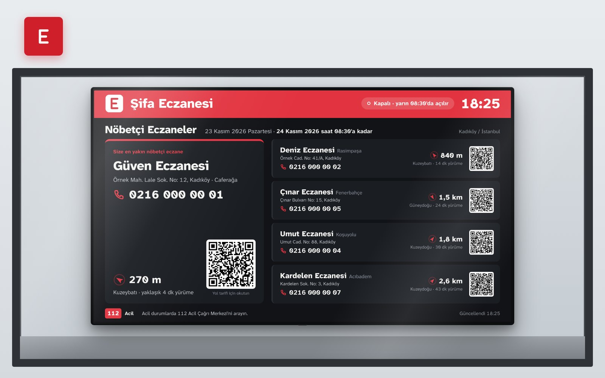
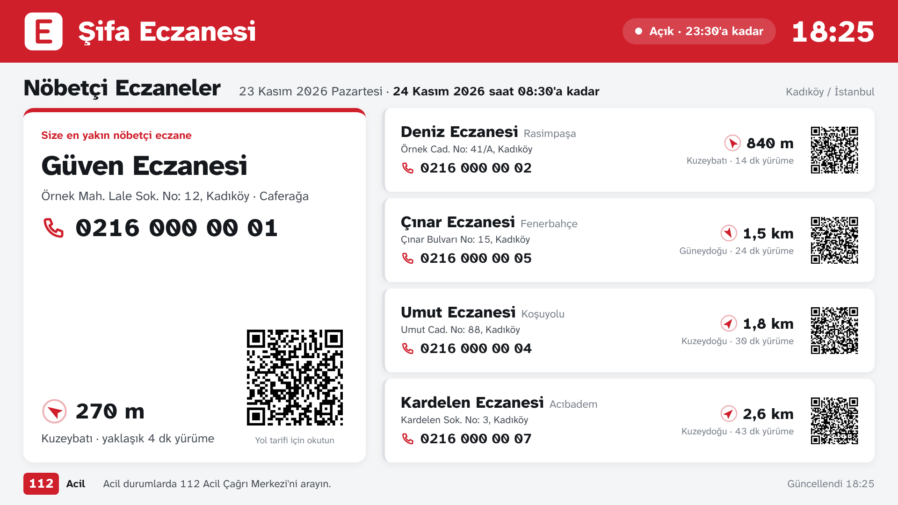
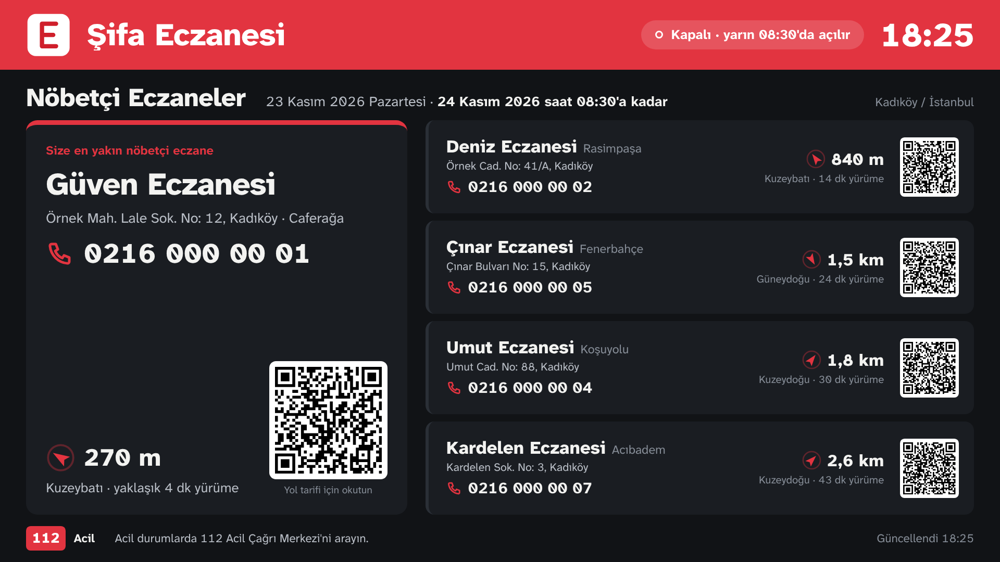
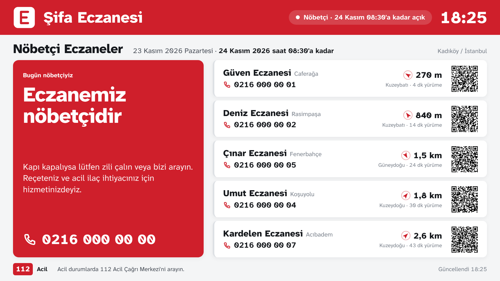
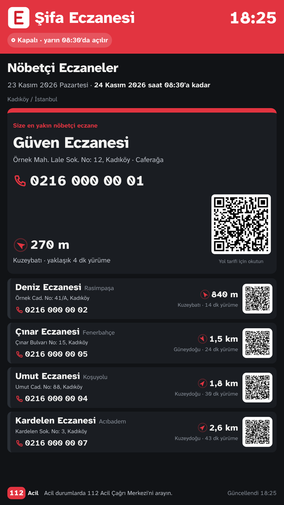
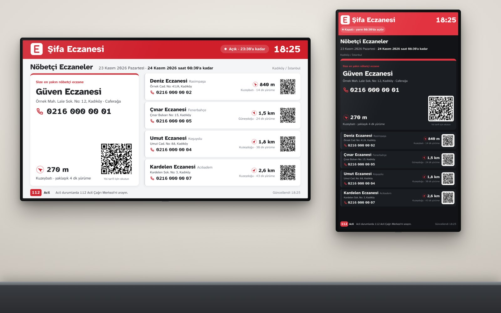
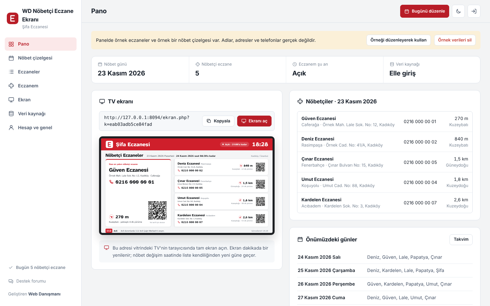
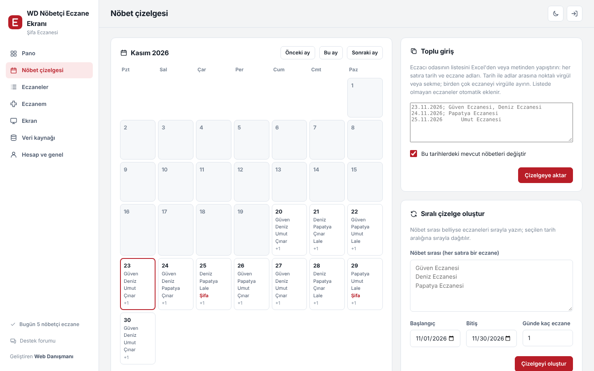
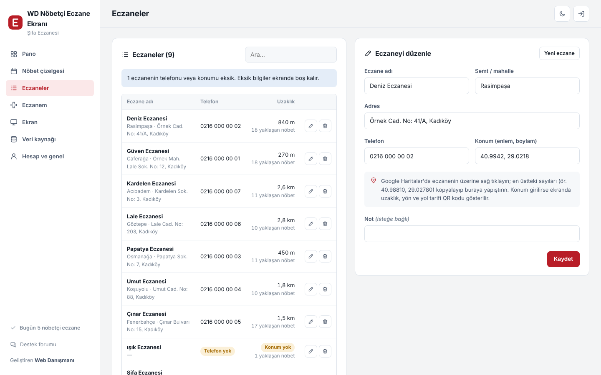
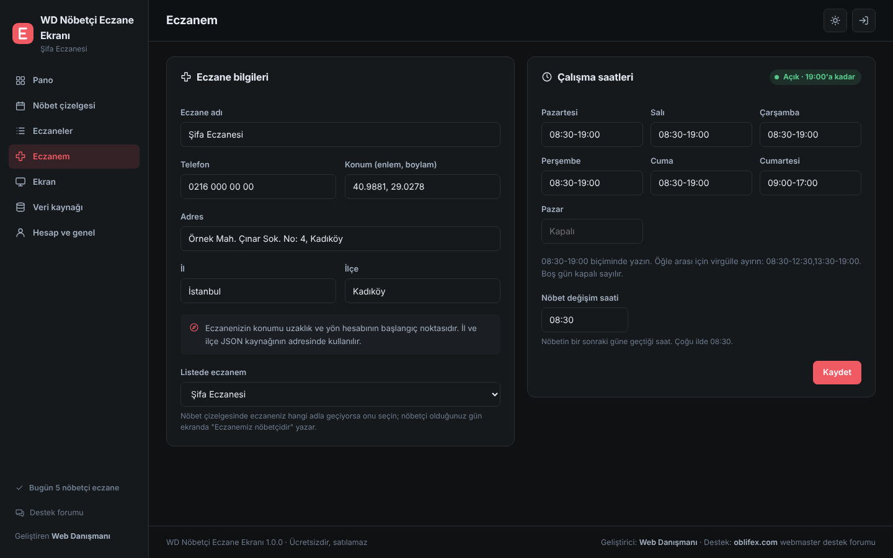

<div align="center">



# WD Nöbetçi Eczane Ekranı

**Eczane vitrini için nöbetçi eczane TV ekranı: en yakın nöbetçi, uzaklık, yön ve yol tarifi QR kodu.**<br>
**A duty pharmacy TV screen for Turkish pharmacy windows: nearest on-duty pharmacy, distance, direction and a directions QR code.**

[](https://www.php.net)
[](#kurulum)
[](#ozellikler)
[](LICENSE)
[](#lisans)

[**Türkçe**](#türkçe) · [**English**](#english)

Geliştirici / Developer: **[Web Danışmanı](https://webdanismani.com)**<br>
Destek / Support: **[oblifex.com](https://oblifex.com)** webmaster destek forumu / webmaster support forum

</div>

---

<a id="türkçe"></a>

## Türkçe

### Nedir?

WD Nöbetçi Eczane Ekranı, eczanenizin vitrinindeki TV'de o günün nöbetçi eczanelerini gösteren ücretsiz bir yazılımdır. Gece kapınıza gelen hasta, en yakın nöbetçi eczanenin adını, telefonunu, kaç metre ötede ve hangi yönde olduğunu görür; telefonuyla QR kodu okutup yol tarifini açar.

Kâğıda yazıp cama asılan listenin yerini alır: nöbet değişim saatinde kendiliğinden yeni güne geçer, eczaneniz nöbetçi olduğu gün "Eczanemiz nöbetçidir" yazar. Kendi hostinginize kurulur; aylık ücret ya da ücretli bir veri servisi gerekmez.

<a id="ozellikler"></a>

### Özellikler

- **En yakın nöbetçi öne çıkar:** Eczanenizin konumuna göre kuş uçuşu uzaklık, pusula yönü (Kuzeydoğu, Güney…) ve yaklaşık yürüme süresi.
- **Yol tarifi QR kodu:** Her nöbetçi eczane için Google Haritalar yol tarifini açan QR kod. Kod TV'de üretilir; dış servise istek gitmez.
- **"Eczanemiz nöbetçidir" modu:** Eczaneniz o gün nöbetçiyse ekran bunu büyük harflerle duyurur, diğer nöbetçileri yanında listeler.
- **Doğru nöbet günü:** Nöbet değişim saati (varsayılan 08:30) ayarlanabilir; gece 03:00'te ekranda hâlâ dünkü nöbetçiler görünür.
- **Açık/kapalı durumu:** Haftalık çalışma saatleri ve öğle arası. Başlıkta "Açık · 19:00'a kadar" veya "Kapalı · yarın 08:30'da açılır" yazar.
- **Otomatik gece teması:** Eczane açıkken açık renk, kapandıktan sonra gözü yormayan koyu tema.
- **Nöbet çizelgesi:** Aylık takvim; günlere eczane atama, eczacı odası listesini Excel'den **toplu yapıştırma**, nöbet sırası belliyse **sıralı çizelge oluşturma**.
- **JSON kaynağı (isteğe bağlı):** Kendi nöbetçi eczane API'nizden veya kullandığınız bir servisten otomatik çeker. `{il}`, `{ilce}`, `{tarih}` yer tutucuları; Türkçe/İngilizce alan adları ve `"loc": "enlem,boylam"` biçimi tanınır. Kaynak yanıt vermezse elle girilen çizelgeye düşer.
- **Kesintiye dayanıklı:** İnternet koparsa ekran son listeyi göstermeye devam eder; liste yoksa 112 uyarısı gösterilir.
- **Yatay ve dikey ekran**, okunurluk için tasarlanmış Atkinson Hyperlegible yazı tipi.
- **Türkçe ve İngilizce** panel, açık/koyu tema, mobil uyumlu.

### Ekran görüntüleri

| Gündüz (eczane açık) | Gece (eczane kapalı) |
|---|---|
|  |  |

| Eczanemiz nöbetçi | Dikey ekran |
|---|---|
|  |  |

| Yatay ve dikey ekran |
|---|
|  |

| Pano | Nöbet çizelgesi |
|---|---|
|  |  |

| Eczaneler | Eczanem ve çalışma saatleri (koyu panel) |
|---|---|
|  |  |

<a id="kurulum"></a>

### Kurulum

**Gereksinimler:** PHP 8.0 veya üstü, PDO (SQLite veya MySQL), mbstring. JSON kaynağı için cURL veya `allow_url_fopen`.

1. [Releases](../../releases) sayfasından `wd-nobetci-eczane-ekrani.zip` dosyasını indirin.
2. Dosyaları hostinginize yükleyin (ör. `nobet.siteniz.com` alt alan adına veya `/nobet` klasörüne).
3. Tarayıcıda adresi açın; kurulum sihirbazında eczanenizin adını ve yönetici hesabını girin.
4. Örnek verileri silin. **Eczanem** sayfasında telefon, adres, konum ve çalışma saatlerini; **Eczaneler** ve **Nöbet çizelgesi** sayfalarında nöbet listesini girin.
5. Panodaki **ekran adresini** vitrindeki TV'de tam ekran açın.

**Konum nasıl bulunur?** Google Haritalar'da eczanenin üzerine sağ tıklayın; en üstte görünen `40.98810, 29.02780` gibi sayıları kopyalayıp konum alanına yapıştırın.

> `data/` klasörü veritabanını tutar; Apache ve LiteSpeed'de `.htaccess` ile korunur. **Nginx** için:
> ```nginx
> location ~ ^/(data|app|lang)/ { deny all; }
> ```

### Nöbet listesini girmenin üç yolu

| Yöntem | Ne zaman? |
|---|---|
| **Takvimden gün gün** | Az sayıda değişiklik için. Güne tıklayıp nöbetçileri işaretleyin. |
| **Toplu yapıştırma** | Eczacı odasının aylık listesi elinizdeyse. Her satıra `23.11.2026; Hayat Eczanesi, Deniz Eczanesi` yazın veya Excel'den iki sütunu kopyalayın. |
| **Sıralı çizelge** | Nöbet sırası belliyse. Eczaneleri sırayla yazın, tarih aralığını ve günde kaç eczane olduğunu seçin. |

### JSON kaynağı

Kendi nöbetçi eczane API'niz varsa **Veri kaynağı** sayfasında adresini girin, örneğin:

```
https://api.siteniz.com/nobetci?il={il}&ilce={ilce}&tarih={tarih}
```

Beklenen yanıt (alan adları Türkçe de olabilir):

```json
{"data":[{"name":"Hayat Eczanesi","district":"Caferağa","address":"Lale Sok. No: 5","phone":"0216 123 45 67","lat":40.9881,"lng":29.0278}]}
```

API anahtarı isteyen servisler için tek satırlık ek başlık (`Authorization: apikey ...`) girilebilir. Liste belirlediğiniz aralıkla önbelleğe alınır; hata olursa 5 dakika beklenir ve elle girilen çizelge kullanılır.

### Güncelleme

`data/` klasörü dışındaki dosyaları yeni sürümle değiştirin. Eczaneleriniz, çizelgeniz ve ayarlarınız korunur.

### Destek

Sorularınız, hata bildirimleriniz ve önerileriniz için **[oblifex.com](https://oblifex.com) webmaster destek forumunu** kullanın.

Kurulum, TV ve kiosk yapılandırması veya özel geliştirme için: **[webdanismani.com](https://webdanismani.com)**

<a id="lisans"></a>

### Lisans

Bu yazılım **ücretsiz paylaşılır ve satılamaz.** [CC BY-NC-SA 4.0](LICENSE) lisansıyla yayınlanmıştır.

- Ücretsiz indirebilir, kendi eczanenizde ve müşterilerinizin eczanelerinde kullanabilirsiniz.
- Değiştirebilirsiniz; değiştirilmiş sürümü aynı lisansla ve Web Danışmanı'nı kaynak göstererek paylaşmanız gerekir.
- Yazılımı veya değiştirilmiş bir sürümünü **satamazsınız**, ücretli bir pakete veya hizmete ekleyerek **dağıtamazsınız**.

Nöbet bilgisinin doğruluğundan listeyi giren veya kaynağı sağlayan sorumludur; resmi nöbet listesi için bağlı olduğunuz eczacı odasını esas alın. Yazı tipi (Atkinson Hyperlegible Next) SIL Open Font License 1.1, QR kod üreticisi (qrcode-generator, Kazuhiko Arase) MIT lisansıyla dağıtılır. Örnek verilerdeki eczaneler, adresler ve telefonlar kurgusaldır.

---

<a id="english"></a>

## English

### What is it?

WD Nöbetçi Eczane Ekranı shows the pharmacies on duty tonight on the TV in your pharmacy window. A patient at your door at night sees the nearest on-duty pharmacy's name, phone, how far away and in which direction it is, and scans a QR code to open directions on their phone.

It replaces the paper list taped to the glass: it switches to the new day at duty change time and says "Our pharmacy is on duty" on your own duty days. It installs on your own hosting with no monthly fee or paid data service. Duty pharmacies are a Turkish system, so the screen is in Turkish; the admin panel is in Turkish and English.

### Features

- **Nearest on-duty pharmacy first** with straight-line distance, compass direction and approximate walking time from your location.
- **Directions QR code** for each pharmacy (Google Maps), generated on the TV with no external requests.
- **"Our pharmacy is on duty" mode** on your own duty days.
- **Correct duty day** with a configurable change time (08:30 by default): at 03:00 the screen still shows yesterday's duty pharmacies.
- **Open/closed status** from weekly opening hours with lunch breaks, and an **automatic night theme** after closing.
- **Duty schedule:** monthly calendar, **bulk paste** from the chamber's list or Excel, and **rotation** generation when the order is fixed.
- **Optional JSON source:** fetch from your own duty pharmacy API or a service you use, with `{il}`, `{ilce}`, `{tarih}` placeholders, Turkish/English field names and `"loc": "lat,lng"`. Falls back to the manual schedule if the source fails.
- **Resilient:** keeps the last list if the internet drops; shows a 112 notice if no list is entered.
- **Landscape and portrait**, the highly legible Atkinson Hyperlegible typeface, **Turkish and English** panel, light/dark theme, mobile friendly.

### Installation

**Requirements:** PHP 8.0+, PDO (SQLite or MySQL), mbstring; cURL or `allow_url_fopen` for the JSON source.

1. Download `wd-nobetci-eczane-ekrani.zip` from [Releases](../../releases).
2. Upload the files to your hosting.
3. Open the address and complete the setup wizard.
4. Delete the sample data, enter your phone, address, location and hours under **My pharmacy**, then the duty list under **Pharmacies** and **Duty schedule**.
5. Open the **screen address** from the dashboard full screen on the TV in your window.

On **Nginx**, block web access with `location ~ ^/(data|app|lang)/ { deny all; }`.

### Updating

Replace every file except the `data/` folder. Your pharmacies, schedule and settings are kept.

### Support

Use the **[oblifex.com](https://oblifex.com) webmaster support forum** for questions, bug reports and suggestions. For setup, kiosk configuration or custom development: **[webdanismani.com](https://webdanismani.com)**

### License

This software is **free and may not be sold.** Released under [CC BY-NC-SA 4.0](LICENSE): you may use it in your own and your clients' pharmacies and modify it; modified versions must be shared under the same license with credit to Web Danışmanı. Selling it or bundling it into a paid package or service is prohibited.

Whoever enters the list or provides the source is responsible for the accuracy of duty information; your pharmacists' chamber's official list prevails. Font: Atkinson Hyperlegible Next (SIL OFL 1.1). QR generator: qrcode-generator by Kazuhiko Arase (MIT). Sample pharmacies, addresses and phone numbers are fictional.
